# CheefBook

App de receitas culinárias para Android. Você cadastra suas receitas com foto e ingredientes, encontra qualquer uma pela busca, guarda as favoritas e pode capturar a receita de outra pessoa para criar a sua própria versão, sem mexer na original.

Trabalho final da disciplina Projeto Integrador VI — Programação para Dispositivos Móveis.
Integrantes: João Victor Vedovato e Luciano Eduardo Allebrandt.

## Funcionalidades

- **CRUD completo** de receitas, salvo em SQLite: criar, ver, editar e excluir.
- **Cadastro e login** com validação dos campos. A senha é guardada como hash (PBKDF2), nunca em texto.
- **Receitas completas:** foto da galeria, categoria, tempo, porções, dificuldade, vegetariana, ingredientes com quantidade e unidade, e modo de preparo.
- **Busca em tempo real** por nome ou ingrediente, junto com o filtro por categoria.
- **Detalhe da receita em abas:** Resumo, Ingredientes e Preparo.
- **Só o autor edita e exclui** a própria receita.
- **Confirmação** antes de excluir, avisando quantas pessoas capturaram a receita.
- **Formulários com validação**: não salva receita sem nome, ingredientes ou modo de preparo, nem conta com e-mail inválido ou repetido.
- **Favoritos** separados por usuário.
- **Captura de receitas:** copia a receita de outra pessoa para a tela Minha versão, onde dá para trocar ingredientes, mudar o preparo e anotar o que mudou.
- **Listas pessoais:** Favoritos, Criadas por mim e Cópias capturadas.
- **Perfil** com foto escolhida da galeria.
- **Mensagens Toast** ao salvar, excluir, favoritar e capturar.
- **Menu lateral (Flyout)**, menu inferior, telas modais, navegação em pilha e abas.

## Telas

Prints tirados do app em execução.

<table>
<tr><td align="center" width="25%"><br><sub><b>Entrar</b></sub></td><td align="center" width="25%">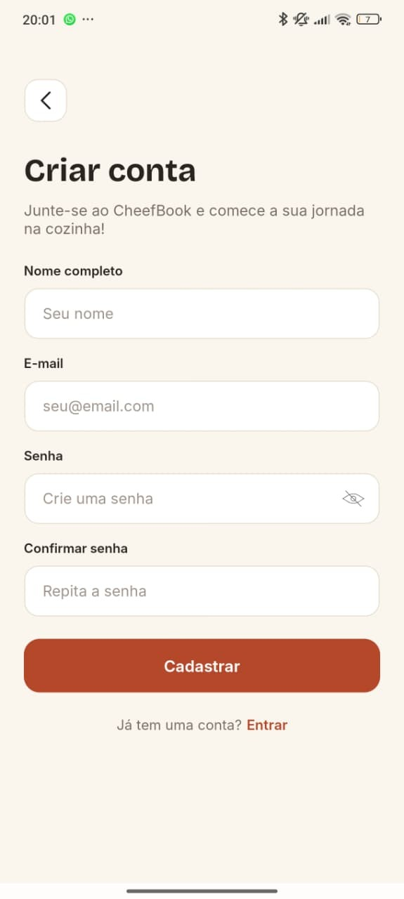<br><sub><b>Criar conta</b></sub></td><td align="center" width="25%">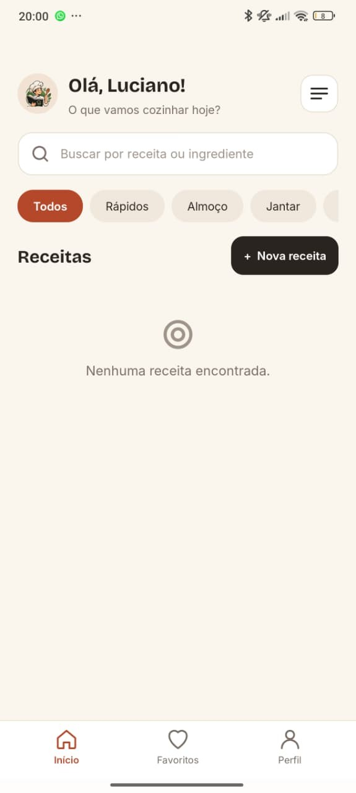<br><sub><b>Início (primeiro acesso)</b></sub></td><td align="center" width="25%">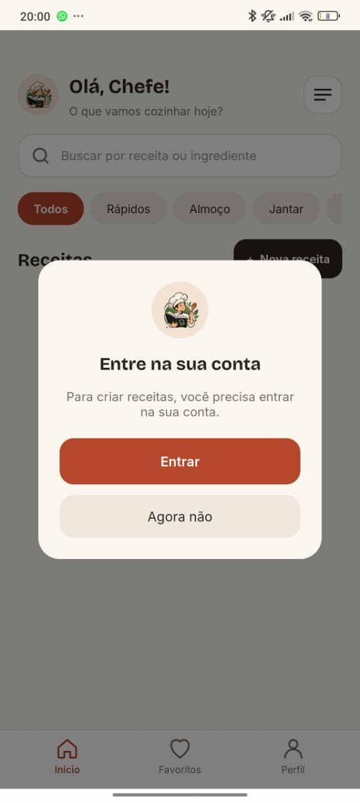<br><sub><b>Aviso para entrar</b></sub></td></tr>
<tr><td align="center" width="25%">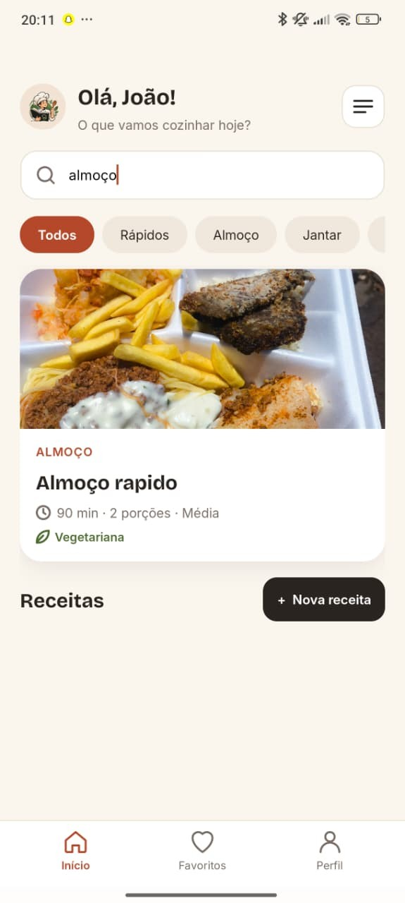<br><sub><b>Busca em tempo real</b></sub></td><td align="center" width="25%">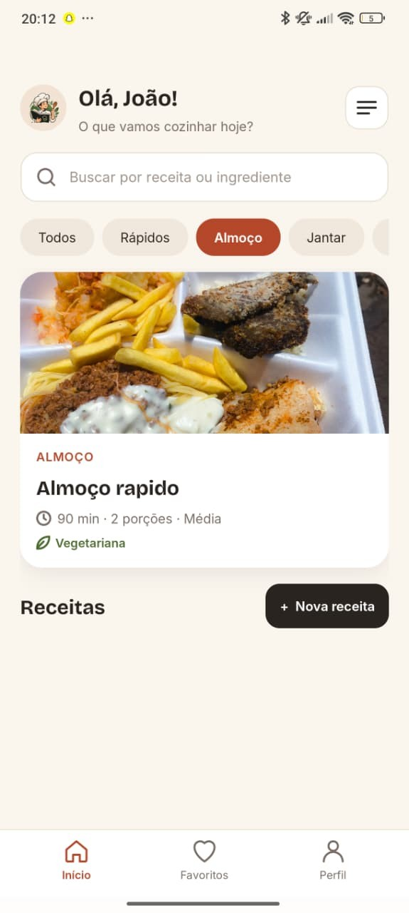<br><sub><b>Filtro por categoria</b></sub></td><td align="center" width="25%">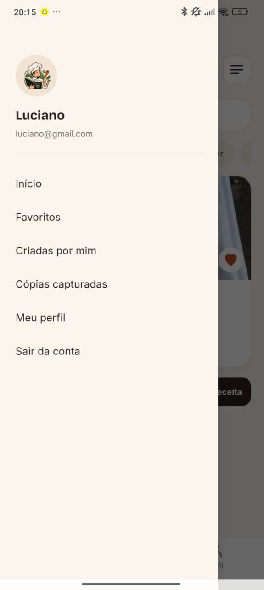<br><sub><b>Menu lateral</b></sub></td><td align="center" width="25%">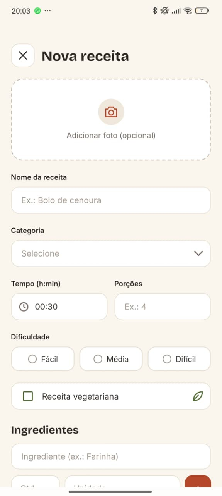<br><sub><b>Nova receita</b></sub></td></tr>
<tr><td align="center" width="25%">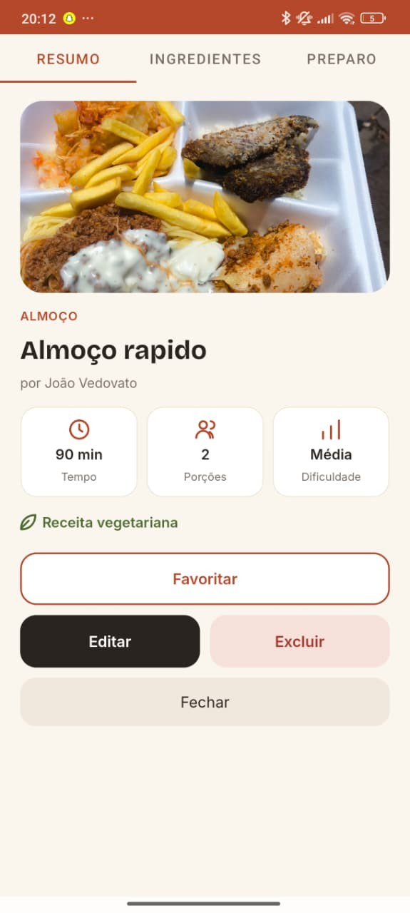<br><sub><b>Receita (autor)</b></sub></td><td align="center" width="25%">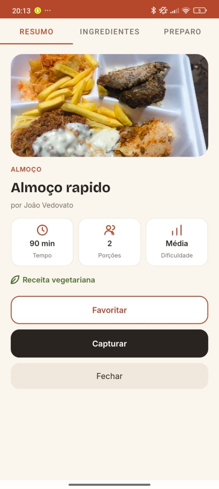<br><sub><b>Receita (outra pessoa)</b></sub></td><td align="center" width="25%">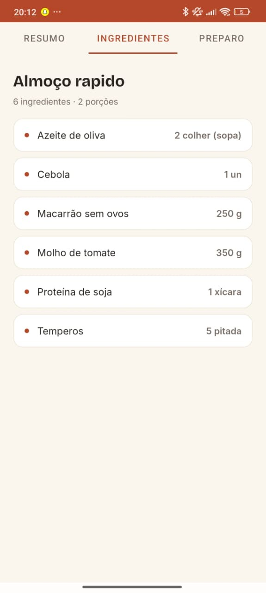<br><sub><b>Ingredientes</b></sub></td><td align="center" width="25%">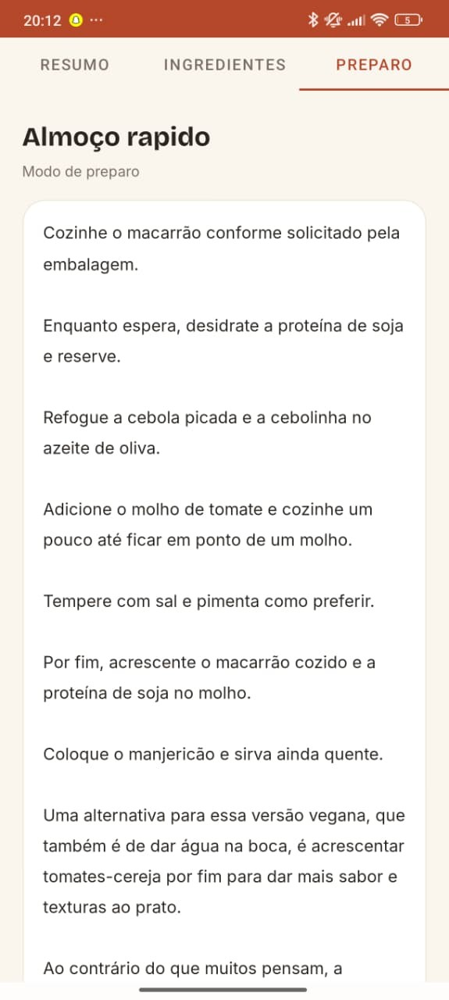<br><sub><b>Preparo</b></sub></td></tr>
<tr><td align="center" width="25%">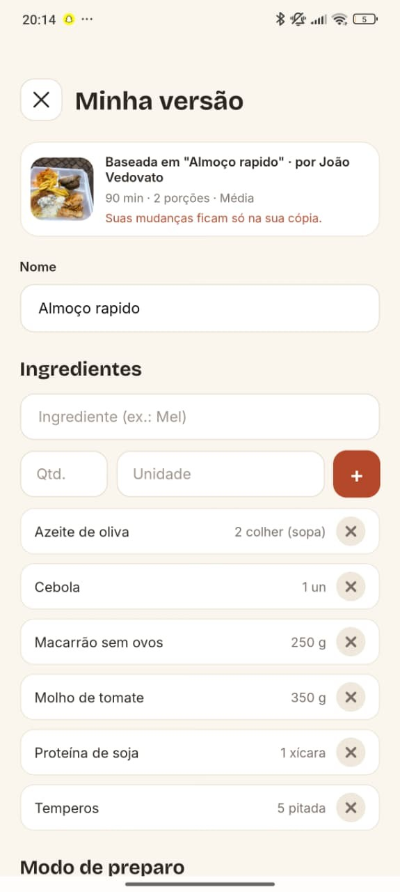<br><sub><b>Minha versão</b></sub></td><td align="center" width="25%">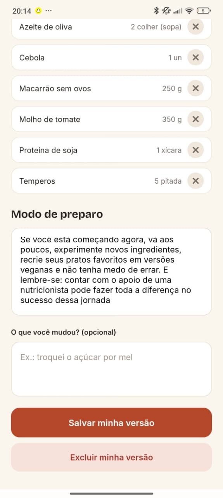<br><sub><b>Minha versão (preparo)</b></sub></td><td align="center" width="25%">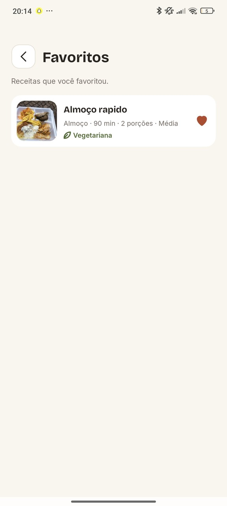<br><sub><b>Favoritos</b></sub></td><td align="center" width="25%">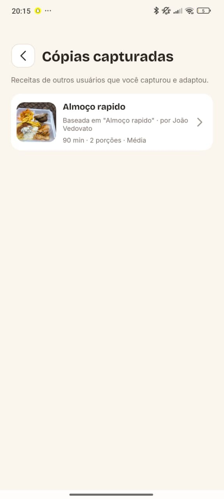<br><sub><b>Cópias capturadas</b></sub></td></tr>
<tr><td align="center" width="25%"><br><sub><b>Meu perfil</b></sub></td><td width="25%"></td><td width="25%"></td><td width="25%"></td></tr>
</table>

## Tecnologias

- C# e .NET MAUI (.NET 10), com as telas em XAML
- SQLite com a biblioteca [sqlite-net-pcl]
- Arquitetura MVVM + DAO
- MediaPicker e Toast nativo do Android
- Fontes Inter e Bricolage Grotesque

## Como executar

**Requisitos:** Windows com o Visual Studio 2026, a carga de trabalho .NET MAUI e o SDK do .NET 10. Para Android, um celular com depuração USB ativada ou um emulador (Android 5.0 / API 21 ou mais novo).

1. Clone o repositório:
   ```bash
   git clone https://github.com/allebrandtluciano23-dot/ProjetoMobileCerto.git
   ```
2. Abra o arquivo `ProjetoIntegradorMobile.slnx` no Visual Studio.
3. Espere o Visual Studio restaurar os pacotes NuGet (é automático na primeira abertura).
4. Na barra de ferramentas, escolha o celular conectado, o emulador ou Windows Machine.
5. Aperte **F5** para compilar e abrir o app.

Na primeira abertura o app começa vazio, só com as categorias (Rápidos, Almoço, Jantar e Sobremesas). Crie uma conta em Entrar → Cadastre-se para cadastrar receitas. Para testar a captura, use duas contas: a segunda abre uma receita da primeira e toca em Capturar.

## Estrutura do projeto

```
ProjetoIntegradorMobile/
├── Views/            Telas em XAML e seus eventos (code-behind)
├── ViewModels/       Um ViewModel por tela (MVVM)
├── Models/           Models: Usuario, Receita, Categoria, Ingrediente...
├── DAO/              Acesso ao banco: um DAO por assunto (Usuario, Receita, Categoria, Favorito, Adaptacao)
├── Data/             Database.cs (cria as tabelas) e DatabaseConfig.cs (caminho do banco)
├── Helpers/          Sessão do usuário, Toast, hash de senha, foto da galeria, cores
├── Resources/
│   ├── Styles/       Cores, ícones e estilos usados em todas as telas
│   ├── Fonts/        Inter e Bricolage Grotesque
│   ├── Images/       Imagens do app
│   ├── AppIcon/      Ícone do app
│   └── Splash/       Tela de abertura
├── AppShell.xaml     Menu lateral (Flyout) e rotas de navegação
└── MauiProgram.cs    Ponto de entrada: fontes e ajustes dos campos de texto
```

**Fluxo das camadas:** a View chama o ViewModel, o ViewModel valida e chama o DAO, o DAO lê e grava no SQLite. Quando os dados mudam, o ViewModel avisa a tela (`INotifyPropertyChanged`) e ela se atualiza sozinha pelos *bindings*.

**Banco de dados (11 tabelas):** `usuario`, `categoria`, `receita`, `ingrediente`, `receita_ingrediente`, `favorito`, `receita_personalizada` e `receita_personalizada_ingrediente`, com campos de texto, número e booleano. As tabelas `plano_alimentar`, `refeicao` e `sugestao` já estão no modelo para versões futuras.

<p align="center">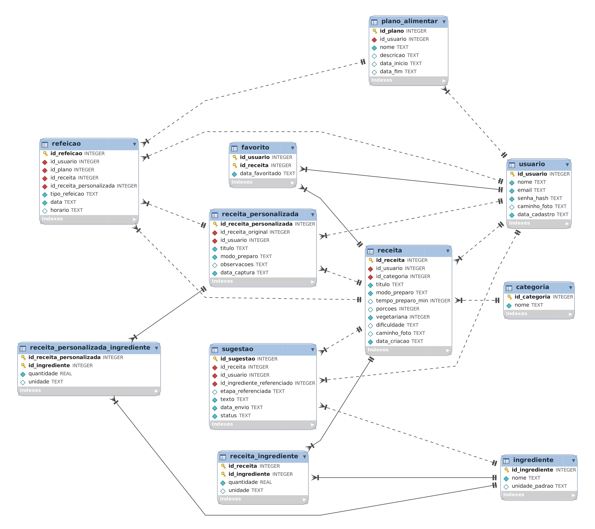</p>
